# LifeLog

A personal log of what you did, what's next and what it cost: the games,
shows, films, books and trips you finished, the backlog you haven't got to,
your notes and habits, and your spending. One JSON file you own, synced
through a private GitHub repo.

Plain HTML, CSS and JS with no build step and no dependencies. The same
files are the web app (GitHub Pages), the Android app and the iOS app
(Capacitor).

## Contents

- [Getting around](#getting-around)
- [Home](#home)
- [Notebook](#notebook): [Notes](#notes), [Images in notes](#images-in-notes), [Habits](#habits)
- [Timeline](#timeline): [Log](#log), [Layouts](#timeline-layouts-covers-and-calendar), [Stats and Recap](#stats-and-recap)
- [Backlog](#backlog): [List](#list), [Covers](#covers), [Pick](#pick), [An item's sheet](#an-items-sheet), [Next releases](#next-releases), [Discover](#discover)
- [Ledger](#ledger): [Expenses](#expenses), [Summary](#summary), [Investments](#investments)
- [Search](#search)
- [Settings](#settings)
- [Imports](#imports)
- [Throughout the app](#throughout-the-app)
- [Setup](#setup): [Run it](#run-it), [Where your data lives](#where-your-data-lives), [Use it on your phone](#use-it-on-your-phone), [Android](#the-android-app), [iOS](#the-ios-app), [Windows and Linux](#the-windows-and-linux-app)
- [Media sources and keys](#media-sources-and-keys)
- [The AI bridge](#the-ai-bridge)
- [Contributing](#contributing)

## Getting around

Five tabs: Home (first on a computer, in the middle on a phone), and Notebook,
Timeline, Backlog and Ledger, each with modes.
On a computer the tabs sit along the top and hovering one drops its modes
out; on a phone they're the bar at the bottom, and holding a tab raises its
modes. Swiping across the page moves between modes on both, and tapping
the tab you're on steps through them. Tabs and modes can be turned off,
reordered and set to open on a given mode, per device. The + button adds
anything from anywhere.

<table><tr>
<td>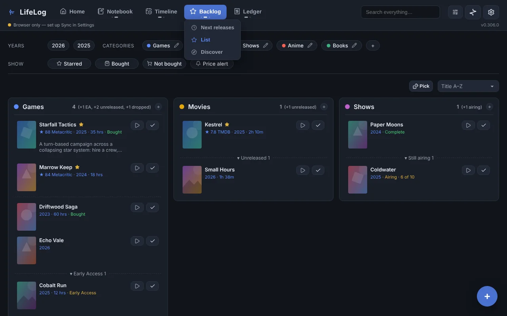</td>
<td>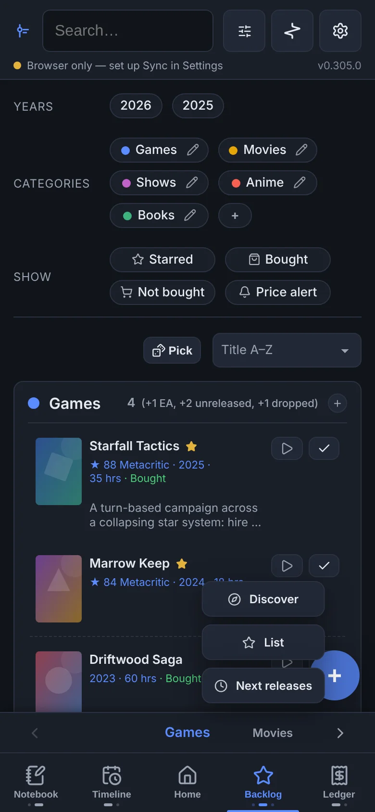</td>
</tr></table>

## Home

What's on now, on one page, and where the app opens (a reload stays where
you were). What you're in the middle of as covers; Coming up for the next
two weeks, with releases and new episodes known to the day, recurring
charges, the habits still left and, once it's connected, Google Calendar's events (hidden from the
panel's menu if you'd rather not); a scratchpad that syncs, with Save to Notebook
to keep what's in it, or switched to Board to sketch on a board instead
(Save to Notebook files it as a board); the notes you pin from a note's ⋯ menu;
a Ledger card with this month's spending so far against last month by the same
day, where it went and your latest expenses; and an Investments card with what
you hold, the gain since you bought and each ticker's month and day; and a
Calendar, the Timeline's calendar in small: a month with a mark on each day
for your Google Calendar events, what you finished, releases and open tasks,
and the picked day's list under it (alone on a wide floor it shows the names
in the days, and right-click it for Show big covers, the days' covers in place of
the names); Pick for tonight, one title from your backlog you could
start today, with Start and Another and chips for what it picks from (it
draws from Pick's own bag, so nothing repeats before everything has had a
turn); and Year so far, what you've finished this year against last year by
the same date, by category, with tasks done, spending and your best habit
run, and Recap › to the year's Recap. A new Home starts with In progress, Coming up and Scratchpad;
the rest, and any section added later, wait to be shown. On a computer you arrange it
in floors: drag a section by its heading into a floor to share its width
(a full floor moves its last section down), or between floors to start a
new one, and right-click an empty spot to add a hidden section there. A phone shows the floors one under the other. View hides
sections, moves them with arrows and resets the layout, per device, and
Settings → Tabs turns Home off.

<table><tr>
<td>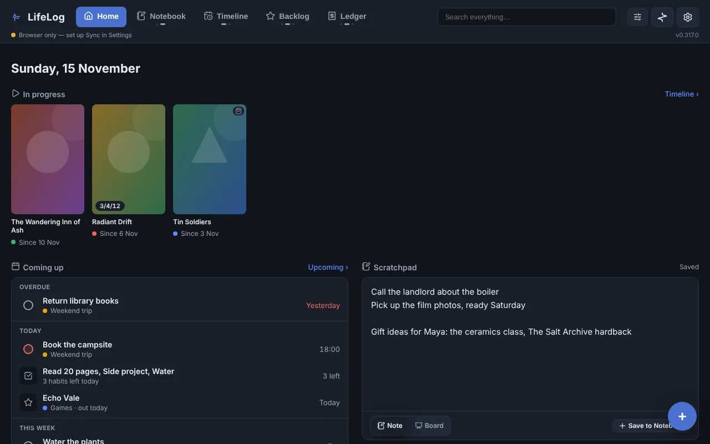</td>
<td>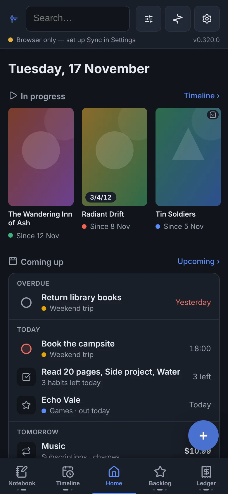</td>
</tr></table>

## Notebook

### Notes

Plain notes (Markdown), tasks and quotes, plus drawing boards with a
hand-drawn look, which can hold pictures (the Image button, a paste or a
drop). Each kind has its own line in the + menu (Note, Tasks, Quote,
Board) and keeps that kind; a new board takes a name and a category first,
then a tap on the blank board opens it to draw. Note categories, favourites,
and collections that open their notes as pages. Tasks tick, reorder by long press (or
by their handles while editing) and merge item by item between devices,
and tapping one (or its pen on the list's page) opens it for a description,
a category, a priority and a date (with a time, a repeat, a reminder and a
deadline). A tasks list is a task itself, with the same fields on its page
and its rows as its subtasks; ticking it ticks them all. Dated tasks and
lists show on Home's Coming up. A
note can become a Timeline entry.

Tags work across every kind and category: give a note, a quote, a tasks
list, a task or a board a few words in its sheet (a board's in ⋯ → Tags),
and the Notebook's Tags row shows everything carrying any tag you pick
(its "+" makes a new tag).
**All tags** renames, merges and deletes them, `#tag` in the search box
asks for one, and a note category can give its tags to every note made in
it.

<table><tr>
<td>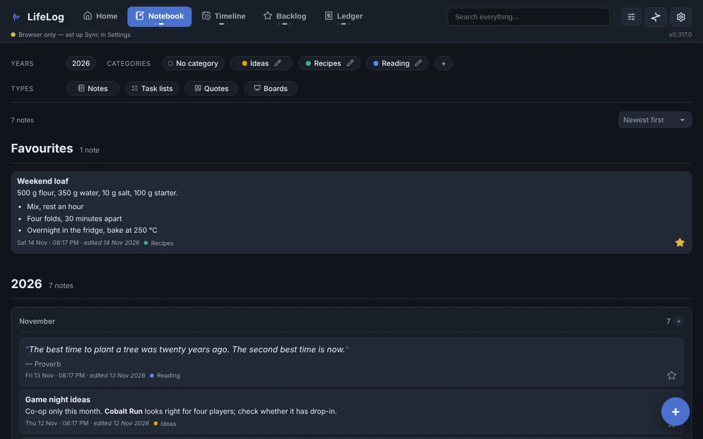</td>
<td>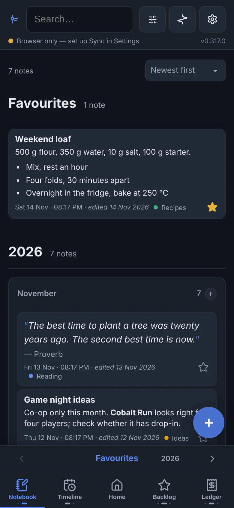</td>
</tr></table>

A note opens as one page with **Read** and **Edit** at the top: the title,
a category chip under it, and the dates at the foot (on a phone, swipe
sideways to switch). The star beside ⋯ makes it a favourite; the ⋯ menu
copies the text, pins it to Home, saves it as a template and exports it
as Markdown or PDF. Type `[[` to link to another note or a board; a
note's Read view lists the notes that link to it under **Linked from**.
Markdown tables show as tables. A template (⋯ → Save as template) is
offered when a new note or tasks list is made, with `{{date}}`,
`{{weekday}}` and `{{time}}` filled in. **Notebook → View**
turns on line numbers in the editor, sets the text size and picks which
view a note opens in.

<table><tr>
<td>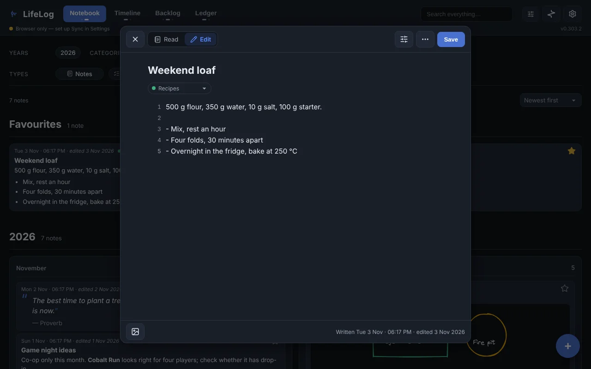</td>
<td>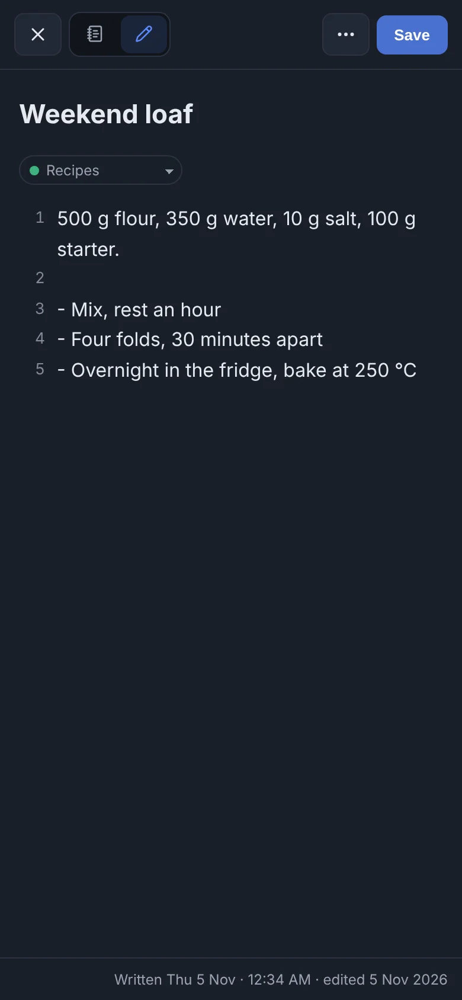</td>
</tr></table>

On a board, ⋯ holds the board options for this device: a grid, snapping to
it, alignment guides while moving, arrows that stick to the shapes they're
drawn between (and follow them), and pen smoothing. A selection can be
grouped (Ctrl+G) or locked (Ctrl+L), a picture cropped (double-tap it), and
a text, shape or picture linked to a note or another board with Link to…;
its link icon opens it. What's written on a board is found by search.

Three more tools put live things on a board: Card places a note, quote,
tasks list or task you can read and edit in place (tick a task, double-click
the text to change it); Player places a YouTube, Spotify or SoundCloud link
that plays on the board once you press play; Panel places a Home panel
(Calendar, Coming up, Ledger…) that stays up to date. On a phone they sit
behind the toolbar's +. A note whose line is only one of those links shows
the player in Read view, again loading nothing until you press play.

### Images in notes

Add image at the foot of a note you're writing, or paste or drop one in. Each sits on its
own line where you put it, shrunk to 1600px. Importing Obsidian notes with
their images (or the whole folder) brings the pictures along; one that
wasn't found shows as a dashed line, and **Find in folder** fills it in.
Images sync on their own branch of the data repo, never inside
`lifelog.json`, and **Settings → Notebook → Clean up** removes the ones no
note shows.

<table><tr>
<td>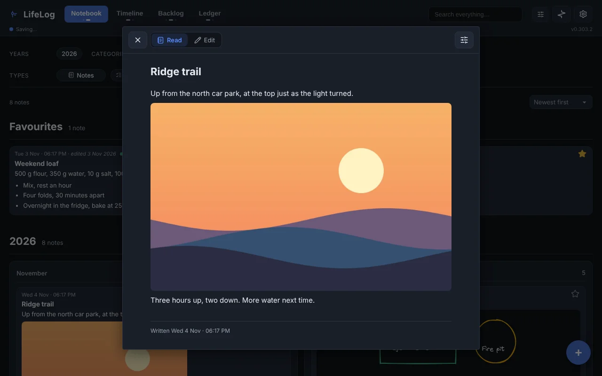</td>
<td>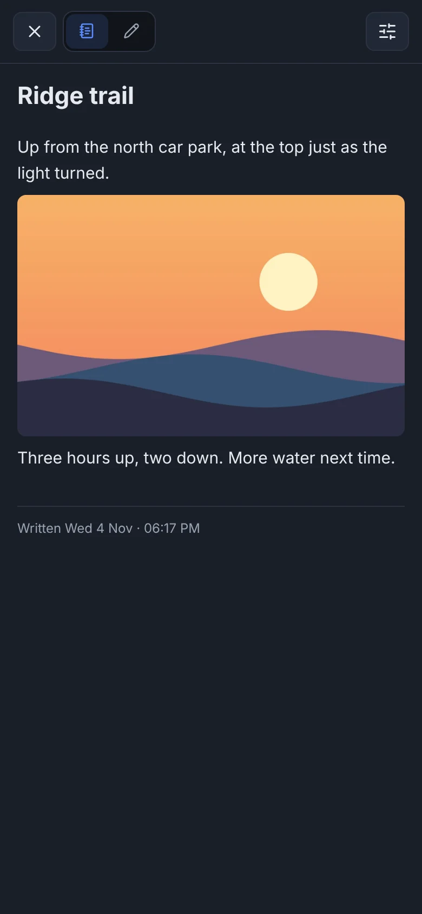</td>
</tr></table>

### Habits

Habits to do or to avoid, every day or on set days, once or several times a
day, or as a goal: a few times a week, month or year on any days, or a time
in minutes ("1 hour a day"). Left to do, at the top, lists what's still open
today and this period, with a button for the next bit (View can hide it). One tap ticks today;
the grid pages back for backfilling. Streaks, a best run, and Insights (kept
rate, longest run, best and weakest weekday, six months as bars). Reminders
on Android and iPhone.

On Android, a habit can tick itself from Health Connect: link it in
Settings → Connections → Health Connect to a step count, a kind of workout
or hours of sleep, and the phone reads them when the app opens (and, if you
like, hourly in the background). Hand ticks still count, and the card shows
today's steps beside the flame. Only the ticks sync; the web and Windows
apps show them and the links, but never read health data.

<table><tr>
<td>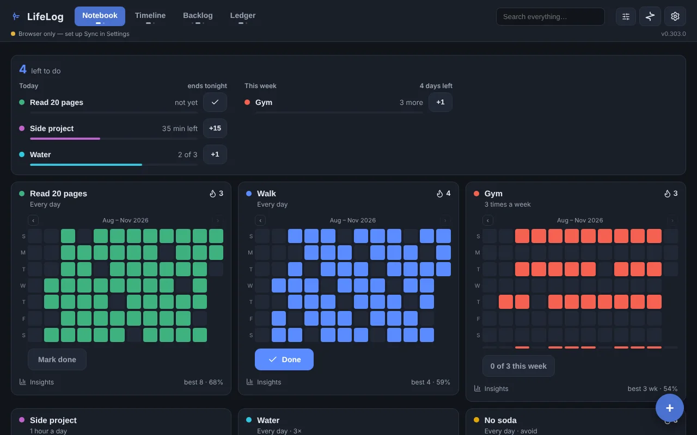</td>
<td>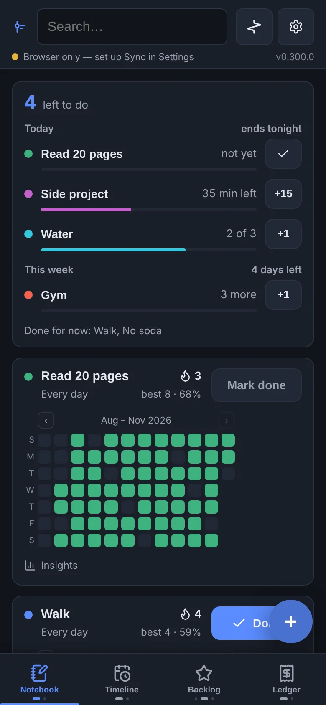</td>
</tr></table>

## Timeline

### Log

What you finished, by year and month, with each year's accomplishments.
An entry has a rating, notes, cover art, genres, a length and when you
started it. With big cover art, the category is a label on the cover and a
book's author sits under the title. What you're in the middle of sits in the
In progress card at the top; ✓ there logs it with the months it took.
Typing a title you already have, in Add entry or Add to backlog, offers
Open on it to go to its card instead of adding it twice.

<table><tr>
<td>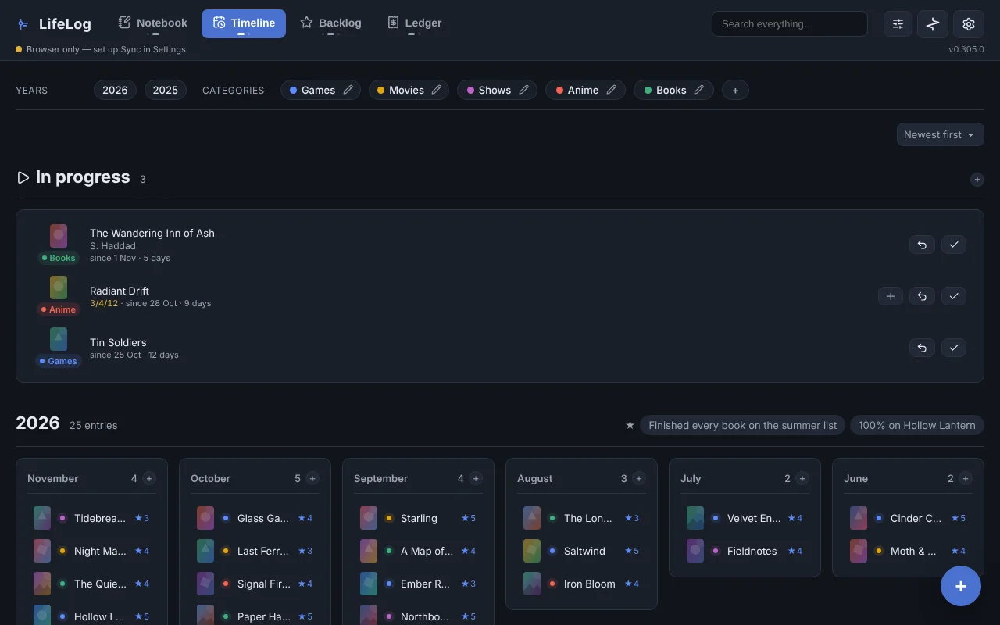</td>
<td>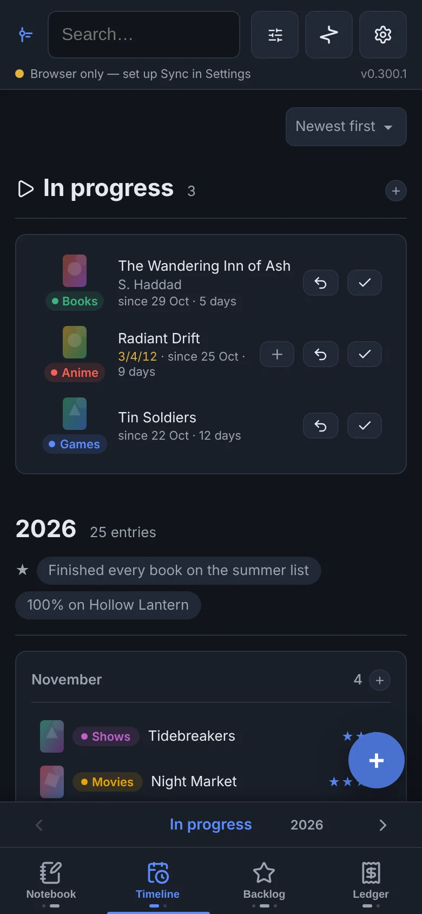</td>
</tr></table>

### Timeline layouts: Covers and Calendar

View → Layout draws the Log as cover art, or as a calendar of the days you
finished things. A picked day lists its entries; entries without a day wait
in No day set. The calendar also shows what the backlog has coming out:
releases and next episodes on their day in a dashed frame, and the ones
known only to the month under the grid (View → Releases on the calendar).

Connect **Google Calendar** in Settings → Connections and your events show
on the same calendar, read only: a line with the time on a computer, a bar
under the day on a phone. Tap one to copy it into LifeLog as an entry, a
task or a note (each opens its own sheet filled in), or to open it in
Google Calendar. Pick which of your calendars show. The events stay on the
device and aren't synced, so each device connects on its own; in a browser
the sign-in lasts an hour, then Sync now fetches again. Google asks only
for reading the calendar list and events, and shows a "hasn't verified this
app" page first (Advanced, then go on).

<table><tr>
<td>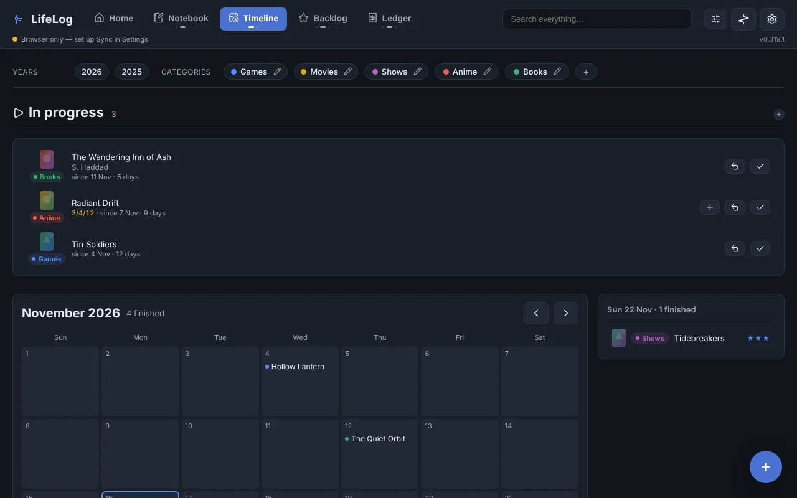</td>
<td>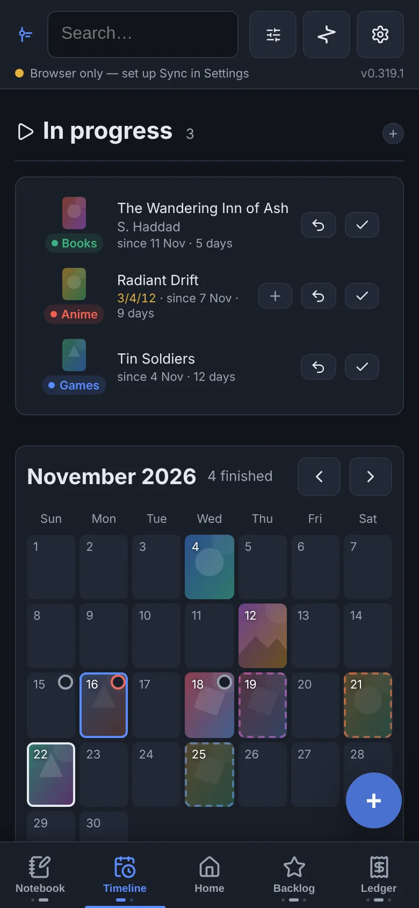</td>
</tr></table>

### Stats and Recap

Totals by category and year, highlights, the monthly pattern, genres, an
activity heatmap, the most repeated titles and that year in numbers.
**Recap** turns a year into a slideshow, offered in December.

<table><tr>
<td>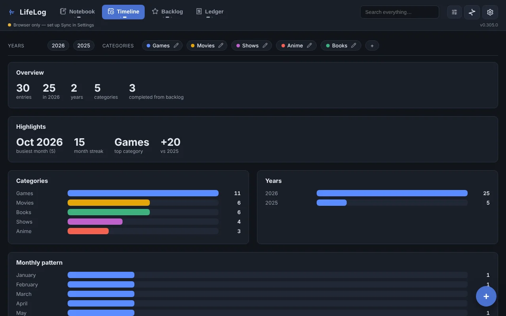</td>
<td>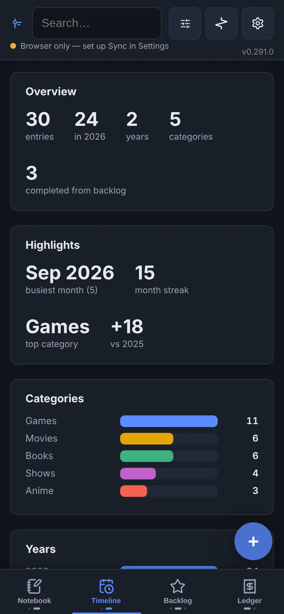</td>
</tr></table>

## Backlog

### List

What you mean to get to, by category, in bands that each fold away:
starred, ready, Early Access or Still airing, unreleased, dropped. Rows
show the score, year, length, price and whether it's bought. Sort inside
each band (name, added, release date, price, length), narrow it with the
Show row (Starred, Bought, Not bought, Price alert), or let Pick choose.
▷ starts an item (it moves to In progress), ✓ logs it on the
Timeline.

<table><tr>
<td>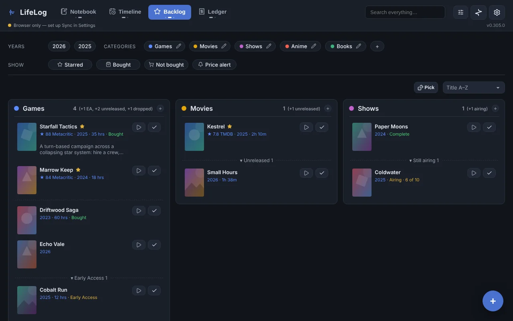</td>
<td>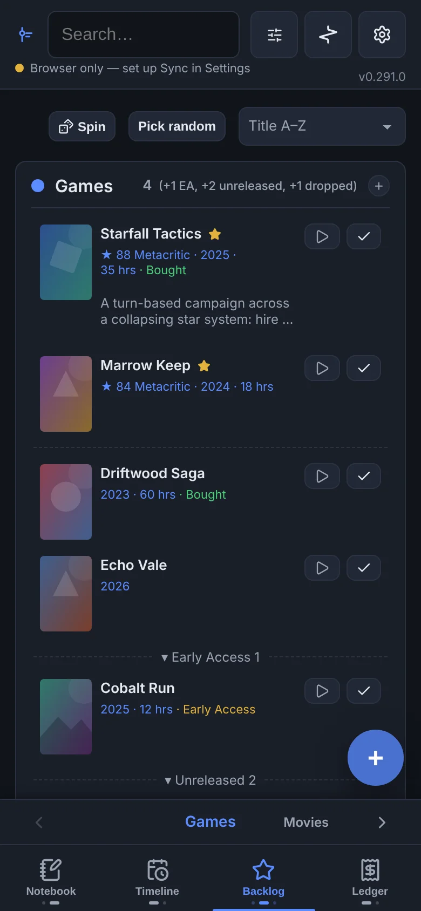</td>
</tr></table>

### Covers

View → Layout → Covers draws any Backlog mode as a wall of cover art, with
marks for starred, bought and price alert. A cover opens like a row. On a
computer, holding the pointer over one shows its release, scores, How Long
to Beat times and, if it isn't bought, its price.

### Pick

Pick lets something else decide. **Backlog** draws one title you could
start today, narrowed by category, Starred, Bought and Short / Medium /
Long, and never repeats until everything has had a turn. It flicks through
covers onto the pick, or spins for it on a wheel; Start puts it in
progress. **My list** is a wheel of your own options.

<table><tr>
<td>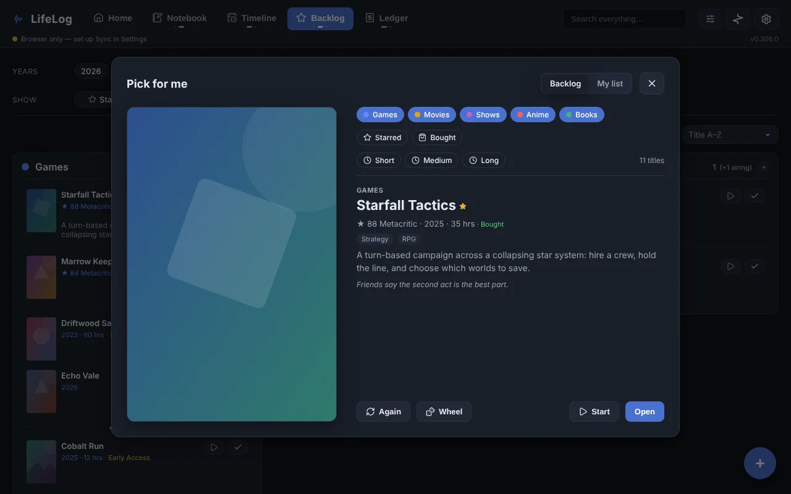</td>
<td>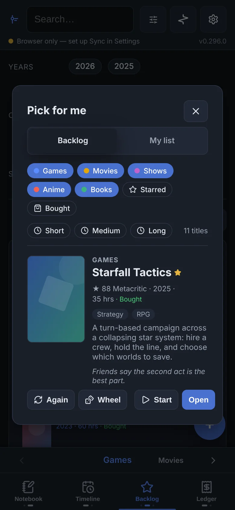</td>
</tr></table>

<table><tr>
<td>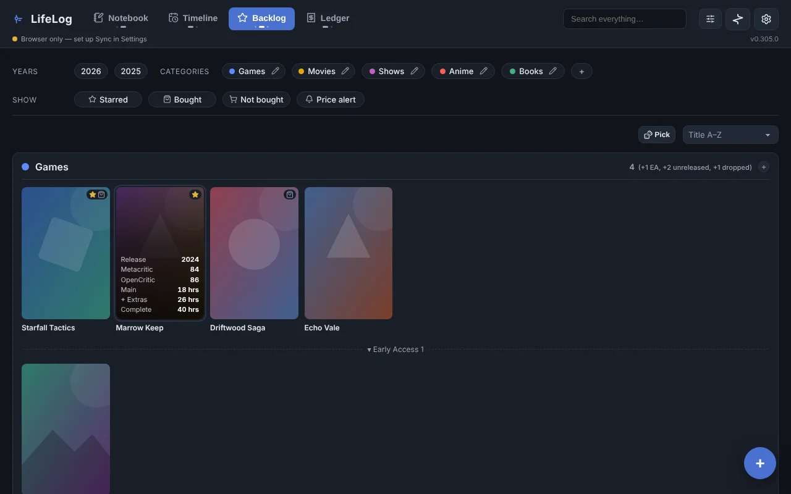</td>
<td>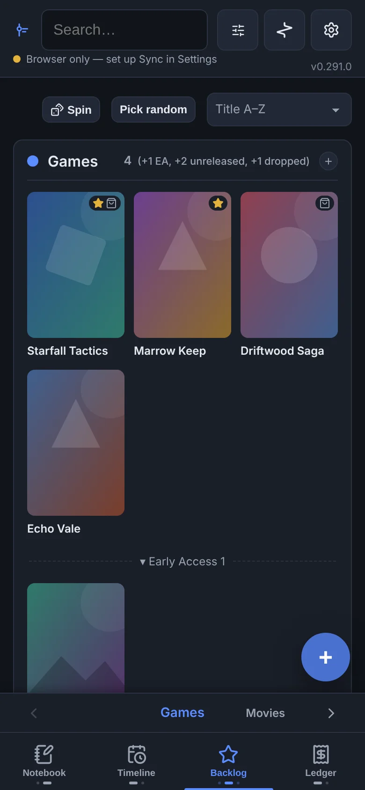</td>
</tr></table>

### An item's sheet

Every item and entry opens in a sheet: the cover with its scores, length and
store links, the description, notes, and Sync to fill it from a media
source. For a Steam game: How Long to Beat times, OpenCritic and Metacritic
user scores, the GG.deals price, and a price alert in US dollars. With IGDB
keys set, IGDB's time-to-beat fills the same strip where How Long to Beat has
nothing, and for IGDB games that aren't on Steam.

<table><tr>
<td>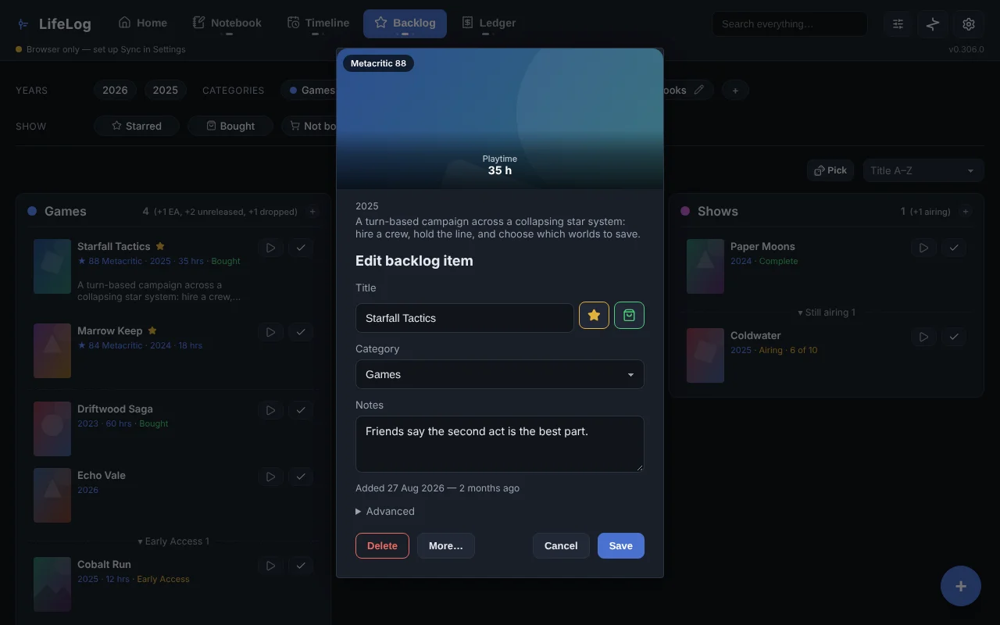</td>
<td>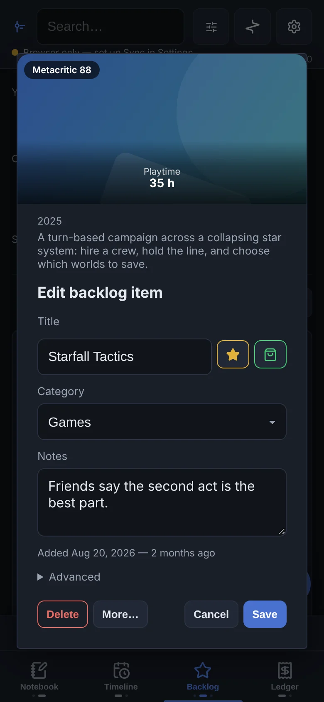</td>
</tr></table>

### Next releases

What's coming, by month, with as much of the date as is known, countdowns
and next episodes, and an Out today card. On the phones, a notification on
release day if you want one, and one when a Steam game drops to your price.
Release dates are re-checked, and again on the day something is due.

<table><tr>
<td>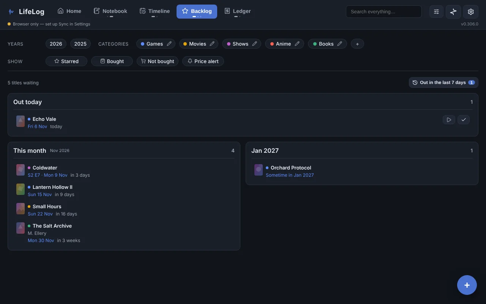</td>
<td>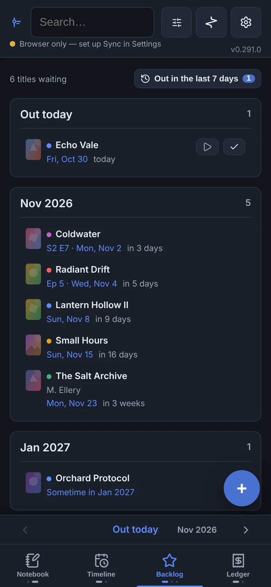</td>
</tr></table>

### Discover

What's popular now and coming soon from the sources your categories use,
with Hide what I have. Books get the NYT bestseller lists with a free New
York Times key, or Hardcover's trending. A category with two lists to show
(RAWG or IGDB, NYT or Hardcover) gets a switch on its card. Logging a
synced title offers the next one in its series.
(No screenshot: it needs the live sources.)

## Ledger

### Expenses

Spending by year and month. Amounts do basic math and take other
currencies at the day's rate. Recurring bills charge on a day you pick
(a weekday, a day of the month, or a date each year) and have pauses, plan
changes, one-off charges, merges and per-charge edits. Projects group a
burst of spending, like a trip; a category can hold subcategories. On the
phones, a reminder before a bill charges; on Android, Google Wallet
payments are offered in. Expenses you keep logging by hand at the same
price on the same day are spotted as a bill, with Make recurring, and a new
expense takes the category its note was filed under last time.

<table><tr>
<td>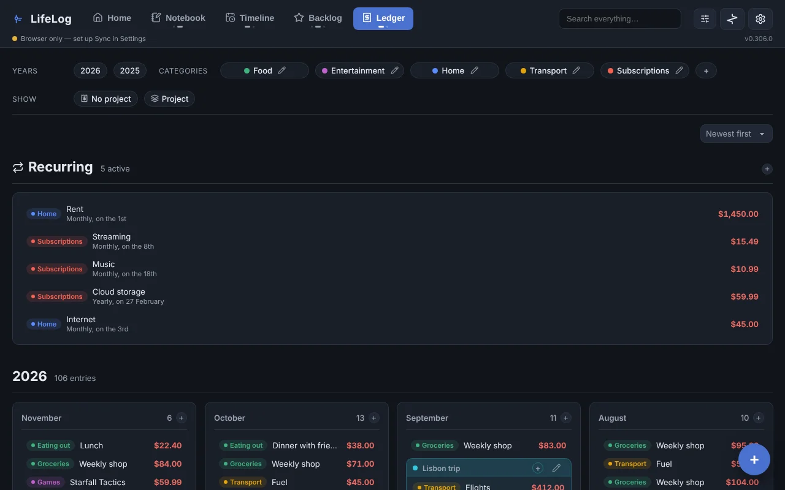</td>
<td>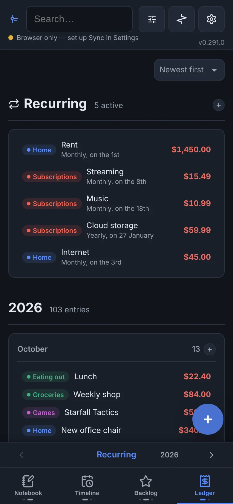</td>
</tr></table>

### Summary

Highlights, this month so far (each category's spend, where it's heading
and its usual month, flagged when it's heading 25% over), recurring, by
month, by category (with subcategories) and the largest expenses.

<table><tr>
<td>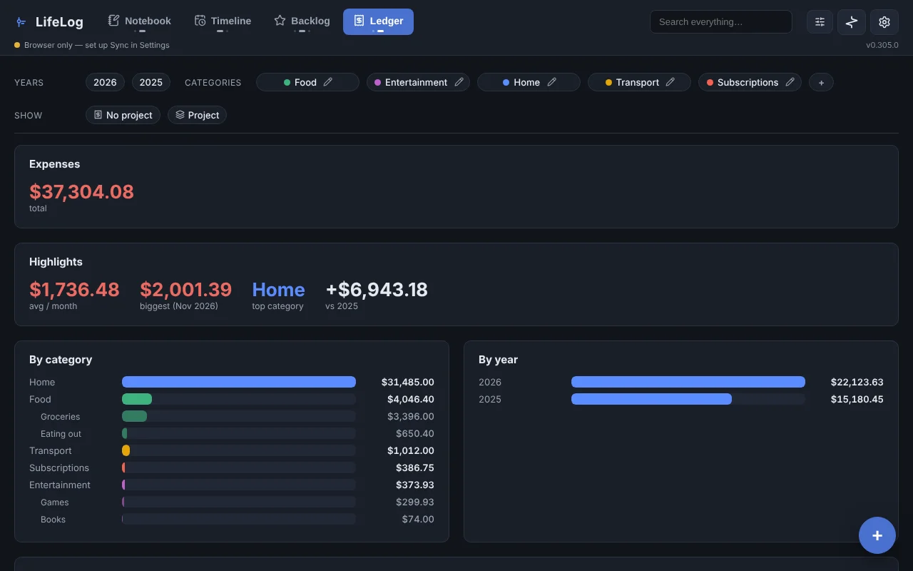</td>
<td>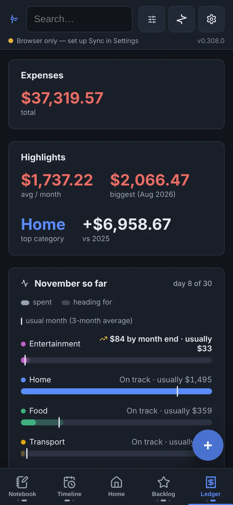</td>
</tr></table>

### Investments

A watchlist of US stocks and ETFs, in dollars: a price chart for each over
a range (1M to Max), a target price and a note, and pins on the days you
want to compare (when you bought, a dip), with the change between each pin
and since the last, or between any two with Compare. Tap the chart to hold
a day, then drag to read the move from it. Log your buys and sales (with
the broker's fee, if any) for a Holding: shares, average cost, value and
gain, counted through stock splits, with the cash dividends paid on the
shares held, everything together ("all in") and, from a year in, the yearly
return. See what the same money would be worth in the S&P 500 (SPY, bought
on the same days), with SPY as a faint line on the chart, and under You hold
what everything was worth over time beside the money you put in. Get a notification when a ticker closes at or under
its target, or at or over it for a price to sell at. Prices come from Tiingo
with a free key of your own: the closes once a day, asked for only after the
market's close (no requests on weekends or market holidays), and while the
US market is open, today's price every 15 minutes or so. Closes are kept on
each device; the watchlist, pins and buys sync in `investments.json`.

<table><tr>
<td>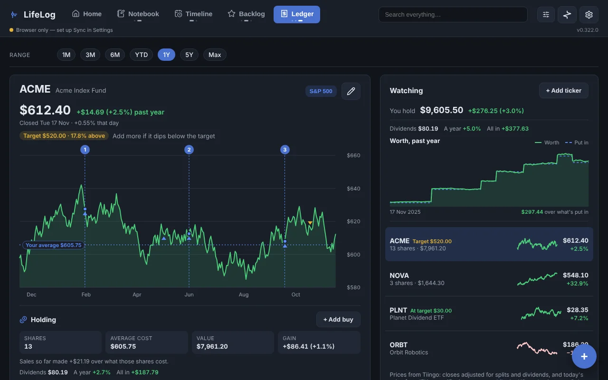</td>
<td>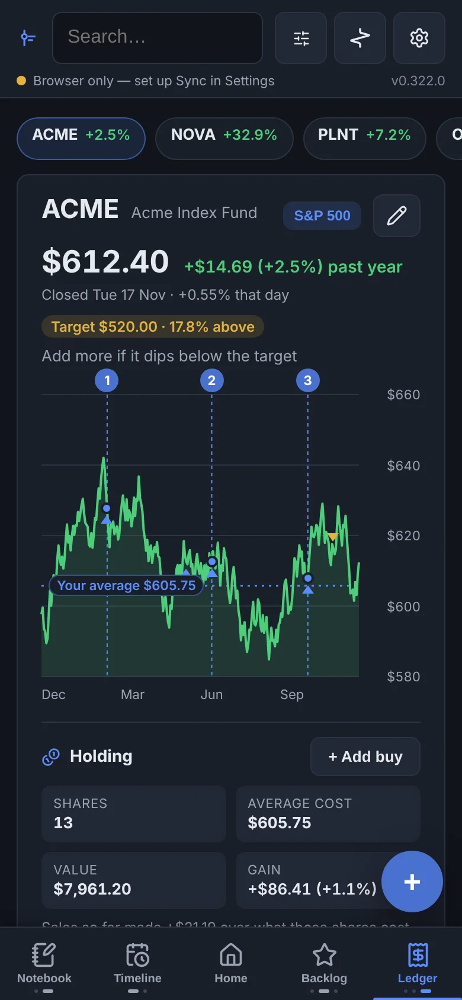</td>
</tr></table>

## Search

One box over everything: entries, backlog, notes, habits, boards, expenses
and Settings pages, grouped by tab. Timeline and Backlog
results show their cover, where they stand (Completed, In progress,
Dropped…) and a star or bag for starred and bought. Filter on a group narrows
that tab instead, for bulk work.

<table><tr>
<td>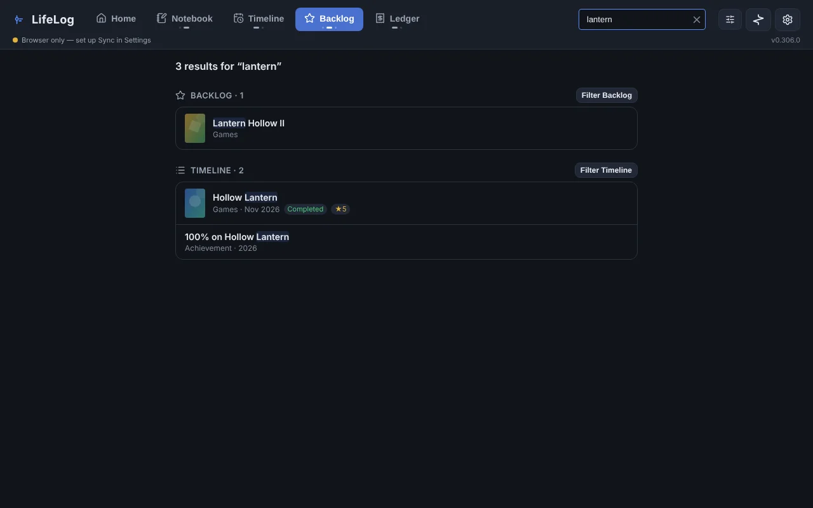</td>
<td>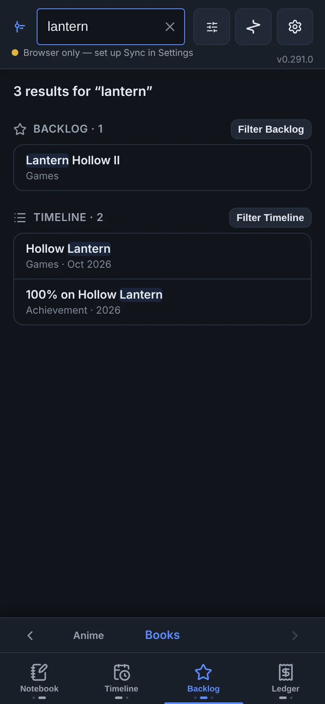</td>
</tr></table>

## Settings

Pages with their own search: sync, import and export, history, app lock,
English or Hebrew (right to left), four themes (Default, Light, Nord,
Dracula), fonts and layout, which day the
week starts on and how dates are written (on every device), tabs, media
lookups, imports, release dates, notifications on the phones, and About
with what's new, the credits, the errors on this device and Test builds.

<table><tr>
<td>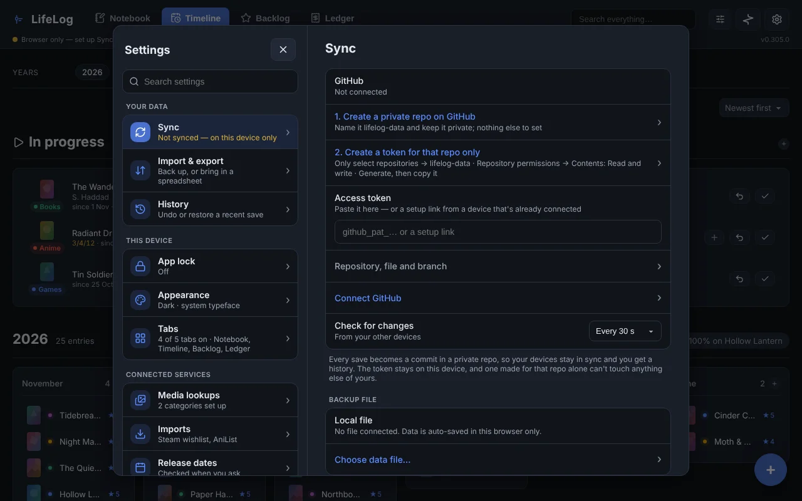</td>
<td>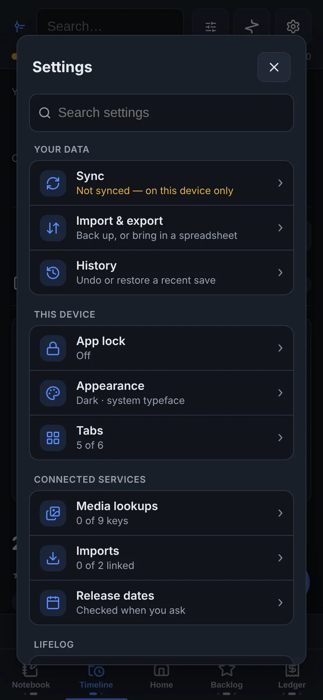</td>
</tr></table>

## Imports

Every import (Steam, AniList, Stremio, Letterboxd, a backup, a CSV, Markdown, PDF and
EPUB notes) opens one review. On a computer it's three columns: filters
(years and months that take a whole period in or out, category, kind, what
to show, new categories to add), the list, and a preview of the row you're
on, with a note drawn as it will look, pictures and all. ↑ and ↓ move, Space
takes a row in or out. On a phone it fills the screen, the filters are
chips, and tapping a row opens its preview. A note whose title is only a
template's label ("Note:") is named by its first sentence. An Excalidraw
drawing (Obsidian's `.excalidraw.md`, or a `.excalidraw` file) picked with
the notes becomes a board, its shapes, text, arrows, colours and pictures
kept: a picture from the vault comes in when its file was picked too (else
it's a dashed box until Find in folder), and a web picture is shown from its
address. Frames, SVG pictures and formulas are left out, and the preview
says so. A Google Maps
list gets the window too, its map beside the list.

<table><tr>
<td>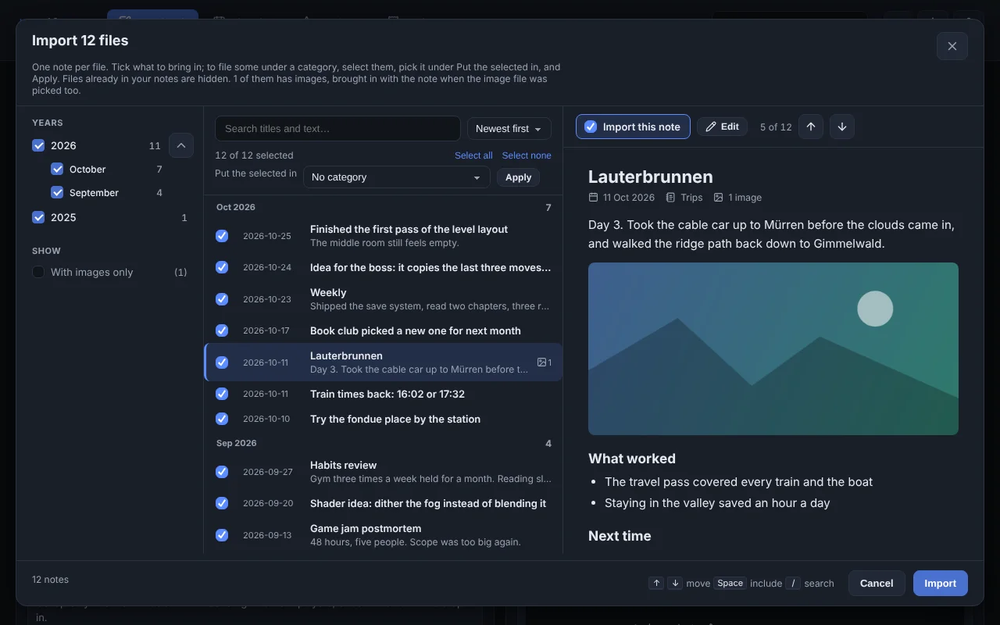</td>
<td>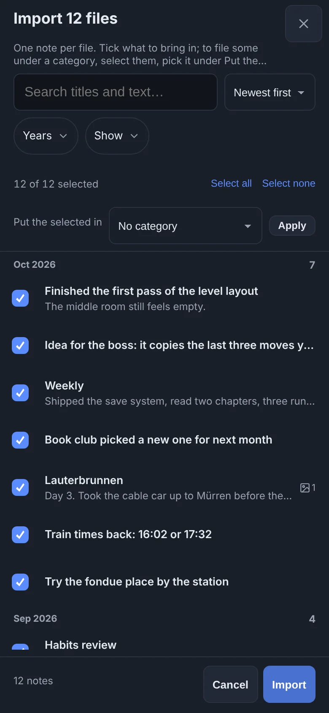</td>
</tr></table>

## Throughout the app

- **Media lookups**: cover art, scores, release dates, genres, descriptions
  and lengths, from a primary and a fallback source per category. See
  [Media sources and keys](#media-sources-and-keys).
- **Imports**: Steam wishlist and played games, AniList, Stremio, Letterboxd, Google
  Maps lists, Markdown, PDF and EPUB as notes, and JSON or CSV per tab.
  Every import goes through one review screen and can be undone.
- **AniList, both ways**: your lists are applied on their own (every open,
  or every day to every month). Planning goes to the Backlog, Watching
  starts an item with its episode count, Completed logs it on the Timeline
  on the day it was finished, Paused and Dropped mark it dropped. Signed
  in, episode counts, starts, finishes and drops go back to AniList; when
  both sides changed, the newer change wins. Shows and manga keep how far
  they've run, and In progress items can count episodes (per category); moved back
  to the Backlog, an item keeps its count and its row shows it.
- **Connections**: Settings → Connections lists each app with where it
  stands; each has its own screen. Hardcover, AniList, Stremio and Steam
  have **What comes in**: new titles through the review, straight in, or
  not at all, a switch per list status, and for the two-way ones whether
  your changes go back.
- **Hardcover, both ways**: pick a category and your Hardcover library
  stays in step with it: Want to Read in the Backlog, Currently Reading in
  progress, Read on the Timeline on the day you finished, Did Not Finish
  dropped. Starts, finishes and drops (Waypage's too) go back to
  Hardcover; the newer change wins. Uses your Hardcover token.
- **Stremio, read only**: sign in once in Settings → Connections (only the key
  Stremio sends back is kept). Your library goes to the Backlog, what
  you're partway through to In progress with the episode you're on, and
  watched movies to the Timeline on the day you last played them, all
  through the review. Stremio keeps only the last play, so earlier watches
  aren't there. The sync never writes to Stremio. It uses the API Stremio's
  own apps use, which isn't public.
  Turn on **LifeLog: Up next** and Stremio's home screen gets a row of the
  movies and shows waiting in your Backlog, from an add-on your proxy
  worker serves (it needs a KV namespace; see proxy/README.md). **Add to my
  Stremio account** puts it in your account's add-ons, so a Stremio on a TV
  gets it with nothing to type.
- **Waypage reading log**: with Share reading activity on in
  [Waypage](https://github.com/danielnoam/waypage), what you read there
  comes in by itself, with a read-only token for its sync repo. A book in
  your Backlog starts and shows how far you are, finishing it puts it on
  the Timeline, one you don't have is added, and a re-read waits for you to
  say so. Reading minutes fill the minutes habit you pick.
- **Trello, both ways**: sign in once in Settings → Connections → Trello
  (a token you paste back) and switch on the Trello lists you want. Each
  is a task list in the Notebook, marked Trello: cards are tasks, due
  dates their date, named labels tags, checklist items subtasks. Ticking a
  task marks its card complete, moves it to the board's Done list or
  archives it (your pick); new tasks become cards and edits go back;
  deleting a task archives its card. It syncs when the app opens, every
  few minutes while open and a few seconds after a change; the newer
  change wins. "Only cards I'm on" leaves the rest of a shared board out.
- **Activity**: anything that takes a while runs in one list, keeps going
  with the app put away on Android, and is offered again if the app was
  closed on it.
- **Share into LifeLog** from other apps on Android and iPhone, and into the
  installed web app: titles go to the Backlog, anything else to an
  item or a note.
- **Bulk actions**: long-press to select, then move, sync or delete.
- **Sync and history**: GitHub and a local file, merged between devices,
  every save in Settings → History to restore or undo, Recently deleted,
  and how much room the GitHub repo has left, with what takes it.
- **App lock**: a PIN, with fingerprint or face where the device has it.
- **Widgets**: on Android, tasks, habits, quick add, spending, note,
  random note, upcoming (releases and dated tasks), in progress, investments and
  calendar (Google or the phone's calendars with tasks and releases, as an
  agenda or a month), with an optional background
  refresh. Quick add and the Tasks widget's + open a small window over the
  home screen, so an entry, expense, backlog item, note or list item goes
  in without opening the app and syncs when it next opens; on iPhone, habits, tasks, quick add, this month and a note.
- **Keyboard**: N adds, number keys switch tabs (hold Shift to see them), F or / searches and Escape stops, Tab opens Settings, ? lists the rest; On a board, a letter picks each tool (V select, P pen, R rectangle…). Settings → Keyboard changes, removes or resets any of them.
- **Offline**: an installable PWA that works with no connection and syncs
  when there is one.

## Setup

### Run it

Double-click **`start.cmd`** (or run `node server.js`) and open
<http://localhost:5173>. Needs [Node.js](https://nodejs.org), and a
Chromium browser (Chrome or Edge) for saving to a local file.

### Where your data lives

The app keeps a working copy on the device and, on every save, writes to
every target connected in **Settings → Sync**:

- **GitHub** (works on phones): `lifelog.json` in a **private repo**, so
  every device shares one log and every save is a commit. Boards and the
  Ledger's watchlist sit beside it in `boards.json` and `investments.json`, and the pictures in notes and on boards on the
  repo's `lifelog-images` branch.
- **Local file** (desktop Chrome and Edge): a `.json` file you pick, for
  example in your Google Drive folder.
- **Google Drive backups** (browser, Android and the Windows app): dated
  copies of everything, without your API keys, in a LifeLog folder in your
  Drive, made when you tap Back up now or on a schedule while the app is
  open. The last three are kept. Restore puts one back as a new save.
  LifeLog asks for Drive's narrowest access (`drive.file`), so it sees
  only the files it made. Backups don't sync: GitHub stays the sync.

With both, GitHub is the live source and the file a backup that mirrors
every save. With neither, the log stays in the browser; Export JSON and CSV
are there for manual backups.
**Settings → Sync → Erase this device** clears everything LifeLog keeps on
that device (data, past saves, pictures, connections, keys) and leaves the
look and language; GitHub, the backup file and Drive aren't touched.
Settings → Import & export → Calendar saves an `.ics` of what's dated in the
next year (tasks with a date, releases and new episodes known to the day,
recurring charges) to open in Google Calendar, Outlook or any calendar app;
it's a copy at that moment, not a feed that updates.

### Use it on your phone

The app is an installable PWA, so once it's hosted over HTTPS it can go on
the home screen and works offline.

1. **Host it** (free): push this folder to GitHub and set repo Settings →
   Pages → Source to **GitHub Actions**; `.github/workflows/pages.yml`
   deploys it once the tests pass. Any static host works too.
2. **Connect sync** on the first device, in Settings → Sync: create a
   private repo named `lifelog-data`, then a fine-grained token with *Only
   select repositories* → `lifelog-data` and *Contents: Read and write*.
   Paste it and press Connect. The token stays in that browser and can't
   reach any other repo.
3. **Add your other devices**: Settings → Sync → Set up another device →
   Copy gives a link that carries the connection. Open it on the phone (or
   scan its QR code in the Android app), then Add to Home Screen.

> The setup link contains your access token. Only open or share it on your
> own devices.

### The Android app

The same files, built into an APK by [Capacitor](https://capacitorjs.com).

- **Getting it**: Android 8 or later. Download `LifeLog.apk` from the repo's Releases page on
  the phone and allow the install. Connect sync with a setup link.
- **Updates**: the app checks for a newer release when it opens and installs
  it over the top, keeping your data.
- **Backups**: the app stays out of Google's backups and phone-to-phone
  transfers, since it holds the log and the token. A setup link brings
  everything back on a new phone. Settings can keep a copy in
  Documents/LifeLog.
- **How it's built**: `.github/workflows/android.yml`, on every push to
  `main` once the tests pass. `tools/build-www.js` copies the files in
  `sw.js`'s `ASSETS` list into `www/`, Capacitor wraps them, and a release
  `app-v<version>` is published whenever `APP_VERSION` is new.
- **Test builds**: a pull request labelled `test` (or `test-android`,
  `test-desktop`, and `test-ios` or `test-linux` when asked) is built onto the pre-release `test-<branch>`. Settings →
  About → Test builds installs one over the app (your data stays), opens it
  in place in a browser, and goes back to the release. The updater never
  offers one.
- **Signing**: releases are signed with the key in the repository secrets
  `ANDROID_KEYSTORE_B64` and `ANDROID_KEYSTORE_PASSWORD` (alias `lifelog`).
  Without them CI builds a test APK and publishes nothing.
- **Building locally** (needs the Android SDK): `npm install`,
  `npm run android:sync`, then open `android/` in Android Studio.

### The iOS app

Built by `.github/workflows/ios.yml` on a Mac runner, only when it's run
by hand (Actions → iOS app → Run workflow), and attached to the current
release as `LifeLog.ipa`.

- **It's unsigned**: without Apple's developer programme it's installed
  with [AltStore](https://altstore.io) or [SideStore](https://sidestore.io),
  which sign it with your own Apple ID and renew it every 7 days.
- **Widgets, reminders, Face ID and the share sheet** are there; the
  widgets' source is in `native/widgets/ios`, added by `tools/ios-widgets.rb`.
- **What differs from Android**: an update is offered as a link to the
  release, the phone backup is in Files → On My iPhone → LifeLog, and
  there's no Markdown folder import.
- Safari's Add to Home Screen still works as the web app.

### The Windows and Linux app

The same files in the system's own WebView, built by
[Tauri](https://tauri.app) (`src-tauri/`): `LifeLog-portable.zip` for
Windows on each release (a portable app, no installer), and `LifeLog.AppImage` or `LifeLog.deb` for
Linux when `desktop.yml` is run by hand with **Linux too** ticked.
The web app opened on a Windows PC offers it once, and keeps a
**Get the Windows app** row in Settings → About.

- **Portable** (Windows, 2026-11-20): unzip `LifeLog-portable.zip`
  anywhere and open `LifeLog\LifeLog.exe`; its data goes in `data` beside
  it, so moving the folder moves the data. There's no Start menu entry or
  uninstaller: pin it yourself, and delete the folder to remove it. Opened
  straight from inside the zip it refuses to start, since Windows runs it
  from a temp folder it empties. Copies installed by the old
  `LifeLog-setup.exe` get one last installer update, then update the
  portable way in the same folder (`src-tauri/src/portable.rs`).
- **Offline and fast**: the files are inside the app, so it opens with no
  connection and without waiting on one, and syncs when it can.
- **No proxy needed**: Steam, SteamGridDB, IGDB, Hardcover, GG.deals, Augmented Steam and
  the Google Maps import go out through the app's own HTTP, as on the
  phones.
- **Its own copy**: it doesn't share a browser's storage, so connect sync
  once with a setup link.
- **The tray**: closing the window keeps LifeLog in the tray, with Add
  entry and Add expense; Quit is in its menu. Habit reminders and the
  charge, release-day and price heads-ups ring while it runs, and a click
  on one opens the habit, the Ledger, Upcoming or the Backlog. In the tray
  it still checks GitHub every 10 minutes.
- **Windows toasts**: on Windows a click works from the Action Center too,
  even after LifeLog was quit, through a `lifelog://toast/` link carrying a
  key only that computer knows (`src-tauri/src/toast.rs`). A habit
  reminder has a Done button and leaves the Action Center once the habit is
  kept. Settings → Notifications has Send a test notification.
- **Pin on top**: the pin button in the top bar, the tray's Pin on top or
  Ctrl+Shift+P turns the window small and always on top, with Today
  (overdue and today's tasks, today's habits, events and releases), Coming
  up, Notes (pinned to Home, else the latest) and the Scratchpad, and a
  line under them that adds a task, a note, an entry or an expense
  ("12.50 coffee"). Unpin puts the window back where and how big it was;
  it stays pinned across restarts. Computer app only.
- **Settings → Desktop**: start at login, into the tray or with the
  window open, and whether closing hides it or quits.
- **Its data folder** (Windows): everything it keeps on the computer
  lives in `LifeLog\data` beside `LifeLog.exe` (moved there from AppData
  on the first start of 0.316, the old copy kept until you remove it). Settings → Desktop → Data folder switches it to AppData or a folder
  you pick, with a restart that copies it over
  (`src-tauri/src/datafolder.rs`). On a copy the old installer put
  there, uninstalling with "Delete the application data" ticked removes it
  there too, but in a folder you picked only LifeLog's own `EBWebView`
  folders, never the rest.
- **Right-click menus**: on any computer, Timeline, Backlog, Ledger,
  notes, boards and habits rows have a menu of their own actions, and
  Select starts selecting from there.
- **Updates**: the update bar installs a new version and restarts when the
  release carries signed update files. On Windows the app downloads the
  new `LifeLog.exe`, checks its signature, renames the running one aside,
  puts the new one in its place and restarts; in a folder it can't write
  to (Program Files) it says so and opens the release page instead. The
  signed files need the repository secrets
  `TAURI_SIGNING_PRIVATE_KEY`, `TAURI_SIGNING_PRIVATE_KEY_PASSWORD` and
  `TAURI_UPDATER_PUBKEY`, from `npx tauri signer generate`. Without them,
  and for a `.deb`, it opens the release page.
- **Windows warns on first open**: `LifeLog.exe` isn't code-signed, so
  SmartScreen asks; choose More info, then Run anyway. Updates the app
  downloads itself don't ask again.
- **How it's built**: `.github/workflows/desktop.yml`, on Windows and
  Ubuntu 22.04 runners on every push to `main`, from
  `node tools/build-www.js --desktop`; the files go on a release only from
  the push that releases it, so an ordinary merge changes no release. A pull request labelled `test` or
  `test-desktop` gets its files on the `test-<branch>` pre-release.
- **Building locally** (needs [Rust](https://rustup.rs), and on Linux the
  WebKitGTK 4.1 packages): `npm install`, `npx tauri icon icon.svg`, then
  `npx tauri build`.

## Media sources and keys

Everything works without a key; a source that needs one stays quiet until
you add it in **Settings → Media lookups**.

| Source | Key needed | Good for |
| --- | --- | --- |
| RAWG | yes (free) | games: ratings, playtime, genres, descriptions |
| SteamGridDB | yes (free) + CORS proxy | games: better cover art |
| IGDB | yes (a free Twitch app's client ID and secret) + CORS proxy in a browser | games: a second source beside RAWG, with play times and early access; time-to-beat where How Long to Beat has none |
| TMDB | yes (free) | films and TV, with next-episode dates |
| GG.deals | yes (free); proxy if CORS-blocked | current game prices |
| Augmented Steam | no; CORS proxy | Steam games: How Long to Beat times, OpenCritic and Metacritic user scores |
| New York Times | yes (free) | books: bestseller lists in Discover |
| Hardcover | yes (your API token, expires) + CORS proxy in a browser | books: series, next in the series, trending in Discover |
| Tiingo | yes (free, personal use); CORS proxy in a browser | the Ledger's watchlist: daily stock and ETF prices |
| Open Library, AniList, Jikan, Google Books, MusicBrainz | no | books, anime and manga, music |
| Stremio | your sign-in (only its key is kept) | your movie and show library and what you've watched, read only; adds the Up next add-on to your account when you ask |

Steam's endpoints and SteamGridDB send no CORS headers, so on the web the
wishlist import, Steam dates, prices and game times need a proxy you host:
`proxy/` is a Cloudflare Worker for a free account. See
[`proxy/README.md`](proxy/README.md). The Android app needs no proxy.

## The AI bridge

`bridge/` lets other AIs read and change LifeLog: an MCP server and a
command line that run the app's own code against the same `lifelog.json`.
Its changes show in Settings → History tagged with the AI's name, and each
can be undone. See [`bridge/README.md`](bridge/README.md) and
[`bridge/DATA.md`](bridge/DATA.md).

## Contributing

`main` takes only pull requests, merged once the Tests check is green.
Only a release bumps the version: `node tools/release.js x.y.z` folds the
notes each pull request left in `changes/` into CHANGELOG.md. The rules,
the release steps and test builds are in [`CONTRIBUTING.md`](CONTRIBUTING.md).
Where the code lives, how to run the tests and how the screenshots here
are taken are in [`ARCHITECTURE.md`](ARCHITECTURE.md).
